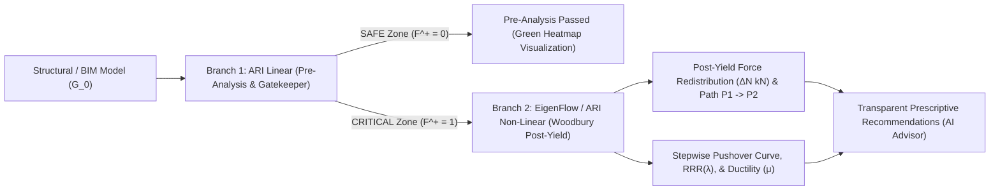

# AdjustedRedundancyIndex_Non-Linear (EigenFlow)

**BIM Structural Post-Yield Transparency & Non-Linear Woodbury Engine — EigenFlow**

This repository provides the scientific implementation of **ARI Non-Linear (EigenFlow)**, the second branch (**Branch 2**) of the **Adjusted Redundancy Index (ARI)** architecture. It computes post-yield force redistribution, stepwise elasto-plastic pushover capacity curves based on the **Sherman-Morrison / Woodbury** matrix identity (Eqs. 4.13d–4.13g), ductility demands ($\mu$), and transparent prescriptive engineering recommendations for structural engineers and AI agents.

---

## Two-Branch Pipeline Architecture



1. **Branch 1 — ARI Linear (Pre-Analysis / Gatekeeper)**:
   - Evaluates intact elastic stiffness $\mathbf{K}_0$, Redundancy Ratio $\text{RR}(\lambda)$, $\text{ARI}_{\text{lin}}(\lambda)$, Collapse Index $\text{CI}_{\text{lin}}(\lambda)$, SVD kinematic leverage $h_e$, and stability margin $m_s(\lambda) = 1 - (1 - \lambda) h_e$.
   - Instantly screens structural elements via the layered forwarding policy $F^+$.
2. **Branch 2 — ARI Non-Linear / EigenFlow (Post-Yield Transparency & AI Recommendations)**:
   - Executes Rank-1 **Sherman-Morrison / Woodbury** matrix inverse updates without $O(N^3)$ matrix refactorization:
     $$\mathbf{K}(\lambda)^{-1} = \mathbf{K}_0^{-1} + \frac{(1 - \lambda) k_e}{1 - (1 - \lambda) h_e} \left(\mathbf{K}_0^{-1} \mathbf{b}_e\right)\left(\mathbf{b}_e^T \mathbf{K}_0^{-1}\right)$$
   - Computes exact force redistribution vectors $\Delta N$ (kN) from the primary load path $P_1$ to the secondary reserve path $P_2$, Residual Reserve Ratio ($\text{RRR}_\lambda$), plastic ductility demand $\mu = \delta_{\text{ult}} / \delta_y$, and provides transparent member resizing or stiffener addition recommendations.

---

## Repository Structure

- `run_all_verifications.py` — Unified single-entry-point verification runner.
- `examples/`
  - `woodbury_nonlinear_solver.py` — Reference finite element solver, Rank-1 Sherman-Morrison/Woodbury matrix inverse updates (Eqs. 4.13d–4.13g), and event-driven elasto-plastic pushover analysis.
  - `eigenflow_core.py` — Core engine for the branched pipeline (ARI Linear $\to$ EigenFlow Non-Linear), load path tracking $P_1 \to P_2$, and prescriptive engineering recommendation generator.
  - `verification_models_nonlinear.json` — Specifications for the 4 canonical dissertation benchmark models (`M1`–`M4`) with elasto-plastic material parameters ($\alpha_h$, $\mu_{\text{ult}}$).
  - `test_woodbury_solver.py` — **Gate 1**: Exact mathematical equivalence tests for Rank-1 Woodbury vs. full matrix inversion (error $< 10^{-12}$) and pushover curve verification.
  - `test_branching_pipeline.py` — **Gate 2**: End-to-end branched pipeline tests and CSV/JSON artifact export.
- `results/verification/`
  - `eigenflow_nonlinear_screening.csv` — Comprehensive evaluation table (ARI Linear + Woodbury Non-Linear ARI).
  - `eigenflow_nonlinear_report.json` — Structured JSON report including pushover curves and yield sequences.

---

## Running Verifications

```bash
python3 run_all_verifications.py
```

---

## License

Apache License 2.0 (See [`LICENSE`](LICENSE)).
