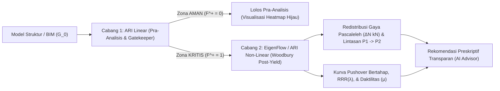

# AdjustedRedundancyIndex_Non-Linear (EigenFlow)

**BIM Structural Post-Yield Transparency & Non-Linear Woodbury Engine — EigenFlow**

Repositori ini merupakan implementasi ilmiah untuk **ARI Non-Linear (EigenFlow)**, yaitu cabang kedua (*Branch 2*) dari arsitektur **Adjusted Redundancy Index (ARI)** yang menghitung redistribusi gaya pascaleleh (*post-yield force redistribution*), kurva kapasitas *pushover* elasto-plastis bertahap berbasis identitas matriks **Sherman-Morrison / Woodbury** (Persamaan 4.13d–4.13g), tuntutan daktilitas ($\mu$), serta rekomendasi rekayasa preskriptif yang transparan bagi *structural engineer* dan agen AI.

---

## Arsitektur Bercabang (Two-Branch Pipeline)



1. **Cabang 1 — ARI Linear (Pra-Analisis / *Gatekeeper*)**:
   - Mengevaluasi kekakuan elastis utuh $\mathbf{K}_0$, Redundancy Ratio $\text{RR}(\lambda)$, $\text{ARI}_{\text{lin}}(\lambda)$, Collapse Index $\text{CI}_{\text{lin}}(\lambda)$, serta *SVD kinematic leverage* $h_e$ dan margin stabilitas $m_s(\lambda) = 1 - (1 - \lambda) h_e$.
   - Menyaring elemen struktur secara instan melalui kebijakan penerusan berlapis $F^+$.
2. **Cabang 2 — ARI Non-Linear / EigenFlow (Transparansi Pascaleleh & Rekomendasi AI)**:
   - Mengeksekusi pembaruan invers matriks Rank-1 **Sherman-Morrison / Woodbury** tanpa pemfaktoran ulang matriks $O(N^3)$:
     $$\mathbf{K}(\lambda)^{-1} = \mathbf{K}_0^{-1} + \frac{(1 - \lambda) k_e}{1 - (1 - \lambda) h_e} \left(\mathbf{K}_0^{-1} \mathbf{b}_e\right)\left(\mathbf{b}_e^T \mathbf{K}_0^{-1}\right)$$
   - Menghitung vektor redistribusi gaya eksak $\Delta N$ (kN) dari lintasan utama $P_1$ ke lintasan cadangan $P_2$, *Residual Reserve Ratio* ($\text{RRR}_\lambda$), tuntutan daktilitas plastis $\mu = \delta_{\text{ult}} / \delta_y$, dan memberikan rekomendasi pembesaran dimensi atau penambahan pengaku secara transparan.

---

## Struktur Repositori

- `run_all_verifications.py` — Skrip verifikasi terpadu satu pintu (*single-entry-point verification runner*).
- `examples/`
  - `woodbury_nonlinear_solver.py` — Solver elemen hingga referensi, pembaruan invers Rank-1 Sherman-Morrison/Woodbury (Pers. 4.13d–4.13g), dan analisis *event-driven elasto-plastic pushover*.
  - `eigenflow_core.py` — Mesin inti pipeline bercabang (ARI Linear $\to$ EigenFlow Non-Linear), pelacakan lintasan beban $P_1 \to P_2$, dan generator rekomendasi preskriptif rekayasa.
  - `verification_models_nonlinear.json` — Spesifikasi 4 model tolok ukur kanonik disertasi (`M1`–`M4`) beserta parameter material elasto-plastis ($\alpha_h$, $\mu_{\text{ult}}$).
  - `test_woodbury_solver.py` — **Gate 1**: Pengujian ekuivalensi matematis eksak Rank-1 Woodbury vs. inversi matriks penuh (galat $< 10^{-12}$) dan verifikasi kurva *pushover*.
  - `test_branching_pipeline.py` — **Gate 2**: Pengujian pipeline bercabang penuh dan ekspor artefak tabel CSV/JSON.
- `results/verification/`
  - `eigenflow_nonlinear_screening.csv` — Tabel hasil evaluasi lengkap (ARI Linear + ARI Non-Linear Woodbury).
  - `eigenflow_nonlinear_report.json` — Laporan JSON terstruktur termasuk kurva *pushover* dan urutan pelelehan (*yield sequence*).

---

## Cara Menjalankan Verifikasi

```bash
python3 run_all_verifications.py
```

---

## Lisensi

Apache License 2.0 (Lihat berkas [LICENSE](LICENSE)).
